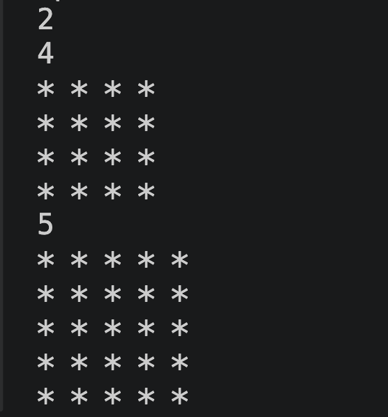
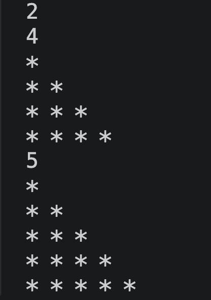
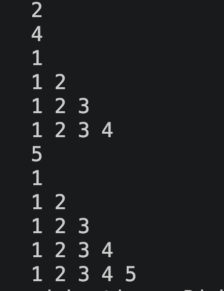
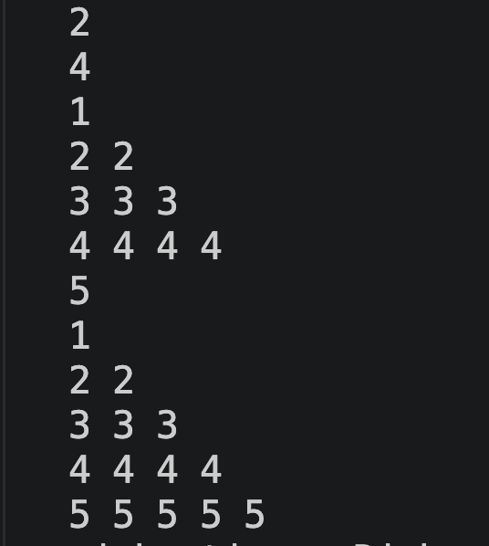
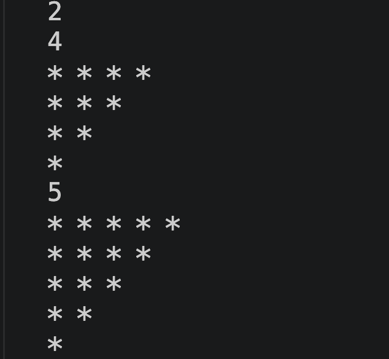
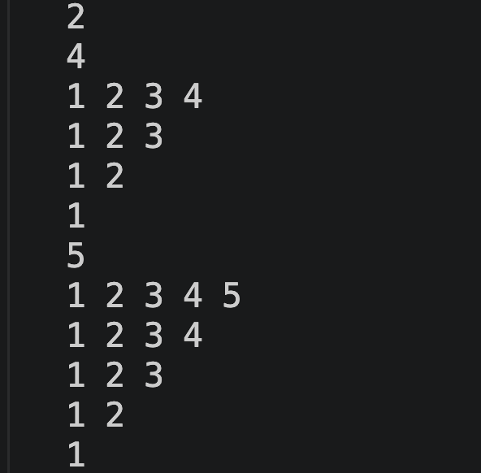

# PatternsNew ⭐

A collection of C++ pattern-printing problems created while
learning C++ programming and improving problem-solving skills.

## 📌 About

This repository contains C++ programs for practising loops,
nested loops, conditional statements, and logical thinking.

I'm building this collection as part of my journey toward
mastering C++ and Data Structures and Algorithms (DSA).

## 📂 Programs

| File | Description |
|---|---|
| `pattern.cpp` | Pattern 1 |
| `pattern2.cpp` | Pattern 2 |
| `pattern3.cpp` | Pattern 3 |
| `pattern4.cpp` | Pattern 4 |
| `pattern5.cpp` | Pattern 5 |
| `pattern6.cpp` | Pattern 6 |

## 🖼️ Pattern Outputs

### Pattern 1

### Pattern 2

### Pattern 3

### Pattern 4

### Pattern 5

### Pattern 6

## 🛠️ Technologies Used

- C++
- Git
- GitHub
- Visual Studio Code

## 📚 Concepts I'm Practising

- C++ fundamentals
- For loops and nested loops
- Pattern printing
- Logical thinking
- Problem-solving
